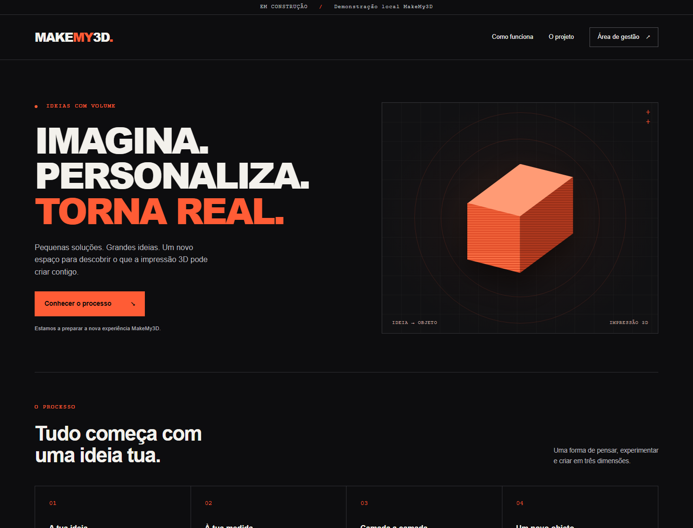
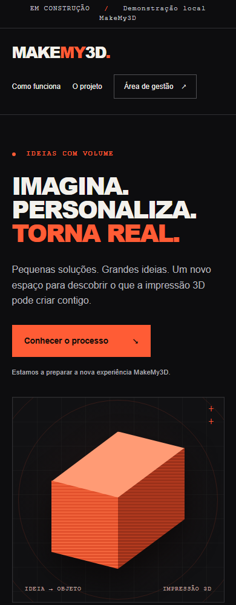

# Relatório de testes — Fase 1

Concluído em 23/10/2026. Âmbito: fundação local, sem catálogo/compras/backoffice funcional de fases futuras.

## Resultados executados

| Verificação | Resultado |
| --- | --- |
| 01_INSTALAR.bat | npm ci, 424 pacotes, saída 0; executado com acesso que permite links de workspace Windows |
| 05_TESTAR.bat após correção da configuração | Saída 0: lint, typecheck, 17 testes Vitest em dois ficheiros e build Next |
| Build Next 16.4.2 | Compilou; / e /admin estáticos; /api/health dinâmico |
| 02_INICIAR_LOJA.bat --smoke em desenvolvimento, porta 3101 | Worker confirmou 200 em /, /admin e /api/health; saída 0 |
| Repetição do smoke com a mesma pasta | Worker confirmou SHA256 preservado e nenhum .writer.lock no fim |
| Produção local, porta 3102 | 200 em /, /admin, /api/health; 404 em /.data/store.json e rota inexistente |
| Reinício produção mesma pasta | SHA256 e0d7281ed4daaaa27a649be6d2e9ba568658a6b03093b4ce0501c7eef9344c1e preservado; lock removido |
| 03_ABRIR_BACKOFFICE.bat --no-browser | Saída 0 com servidor de produção ativo; URL /admin confirmada |
| 04_REPOR_DEMO.bat em work/reset-test | Worker testou cancelamento e confirmação REPOR DEMO; backup verificado no disco |
| Scripts antigos 00_CLONAR e 01_COPIAR | Saída 0; só verificam raiz/contexto, sem alterar outra pasta |
| node --check scripts/server.mjs e scripts/windows.mjs | Passou |
| git diff --check | Passou nas alterações da fase |
| git diff origin/main --exit-code -- index.html | Baseline HTML intacta |
| git check-ignore | Dados, .env.local, node_modules e work excluídos |
| Inspeção visual Chromium headless | Capturas 1440×1100 e 390×1000 inspecionadas; conteúdo visível sem sobreposição/corte horizontal |
| npm audit --omit=dev --json | Zero vulnerabilidades reportadas nas dependências de execução |

## Cobertura dos 17 testes

Seed só quando ausente; persistência após reabrir e após outro processo Node; 30 updates concorrentes sem perda; segundo processo/instância recusados; reset recusado sob lock; exceções e schema inválido preservam bytes e deixam fila recuperável; falha de rename preserva snapshot e remove temporário; JSON corrompido e schema desconhecido preservados; confirmação obrigatória e backup de reset; uploads preservados; backup de JSON inválido; caminho public e operações após close recusados; health sem dados privados; contratos de seed/personalização/preço/categoria; configuração .env.local com precedência de terminal e rejeição de configuração divergente por modo.

## Problemas encontrados e resolvidos

- Sandbox bloqueou ligação npm workspace e rename no Temp virtual: instalação executada com acesso apropriado, testes em work/tests isolado e ignorado pelo Git.
- Lint inicial assinalou âncoras e configuração PostCSS: corrigidos antes da passagem final.
- Encerramento forçado de servidor Windows poderia deixar lock: host Next com encerramento por IPC privado e SIGINT/SIGTERM; sem endpoint público de shutdown.
- Configuração diferente entre Next e CLI poderia repor outra pasta: carregador env partilhado e teste de regressão.
- Recuperação de lock usava token sem validação suficiente: UUID, formato, PID e diretório agora verificados antes da operação.
- Primeira tentativa de browser/script admin de outro contexto sandbox não alcançou o servidor; repetir no mesmo contexto de execução com acesso adequado passou. Capturas finais substituem as imagens dessa tentativa falhada.

## Limitações reais

A auditoria npm completa reporta cinco ocorrências high, todas na cadeia de desenvolvimento eslint-config-next → @next/eslint-plugin-next → fast-glob → micromatch → braces (GHSA-vfj7-8cjw-p6xm). A versão braces disponível consultada é 3.0.3, ainda assinalada; npm sugere downgrade incompatível do preset Next. Não foi aplicado npm audit fix --force nem downgrade automático. Rever na fase QA, antes de usar estas ferramentas com padrões não confiáveis. A auditoria sem dev reporta zero, o que não é uma garantia geral de segurança.

Não foram executados testes de compras, uploads, autenticação ou gestão: essas funcionalidades não existem nesta fase. A revisão visual é um smoke de dois viewports, não uma auditoria completa de acessibilidade nem uma suite Playwright. O script de admin foi validado sem abrir o browser pessoal; o renderer headless foi usado para as capturas. Dados de teste isolados; nenhum pagamento, deploy ou merge na main.

## Evidências visuais

